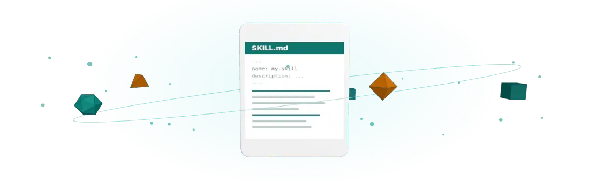

<p align="center">
  <picture>
    <source media="(prefers-color-scheme: dark)" srcset="assets/hero-dark.webp">
    
  </picture>
</p>

<h1 align="center">my-skill</h1>

<p align="center">
  Skill contoh bawaan template: merangkum teks panjang jadi satu kalimat inti dan tiga butir.<br>
  Siap dipasang di Claude Code, claude.ai, Codex, dan platform lain.
</p>

<p align="center">
  <a href="https://github.com/OWNER/skill-template/actions/workflows/ci.yml"></a> <!-- public-only -->
  <a href="https://github.com/OWNER/skill-template/releases"></a> <!-- public-only -->
  <a href="LICENSE"></a> <!-- public-only -->
  <a href="https://github.com/OWNER/skill-template/stargazers"></a> <!-- public-only -->
  <a href="CONTRIBUTING.md"></a>
</p>

<p align="center">
  
  
  
  
</p>

<!-- template:start -->
> **Ini template.** Klik **Use this template** di GitHub, clone hasilnya, lalu jalankan:
>
> ```bash
> ./scripts/init.sh nama-skill-anda owner-github-anda "Nama Anda"
> ```
>
> Tambahkan `--private` di akhir untuk repo privat (badge yang butuh repo publik dibuang). Panduan lengkap ada di [docs/GETTING-STARTED.md](docs/GETTING-STARTED.md). Blok ini hilang setelah `init.sh` dijalankan.
<!-- template:end -->

## Isi

- [Ringkasan](#ringkasan)
- [Cara kerja](#cara-kerja)
- [Contoh keluaran](#contoh-keluaran)
- [Pemasangan](#pemasangan)
- [Dukungan platform](#dukungan-platform)
- [Struktur repo](#struktur-repo)
- [Tanya jawab](#tanya-jawab)
- [Pengembangan](#pengembangan)

## Ringkasan

`my-skill` adalah skill agent dengan format `SKILL.md`. Agent memuat instruksinya saat permintaan pengguna cocok dengan deskripsi skill, lalu mengikuti alur dan format keluaran yang sudah ditetapkan.

> **English summary:** `my-skill` is an agent skill in the `SKILL.md` format. It works as a Claude Code / claude.ai plugin, a Codex plugin, or through `npx skills`, with paste-in instructions for platforms that don't support skills.

## Cara kerja

<p align="center">
  
</p>

## Contoh keluaran

Masukan: "Tim kami memindahkan build dari Jenkins ke GitHub Actions. Waktu build turun dari 14 menit ke 9 menit karena cache dependensi. Biayanya naik sedikit karena runner berbayar."

```
Inti: Pindah dari Jenkins ke GitHub Actions memangkas waktu build, dengan biaya sedikit lebih tinggi.
Butir:
- Waktu build turun dari 14 menit ke 9 menit.
- Penyebabnya cache dependensi.
- Biaya naik sedikit karena runner berbayar.
```

## Pemasangan

### Claude Code

```bash
claude plugin marketplace add OWNER/skill-template
claude plugin install my-skill@starter
```

Satu langkah: `/plugin install my-skill --marketplace OWNER/skill-template`.

### Semua agent lewat `npx skills`

```bash
npx skills add OWNER/skill-template
```

`npx skills add` mencari skill di folder `skills/` pada akar repo.

### claude.ai dan Claude Desktop

Paket berbayar (Pro, Max, Team, Enterprise): **Customize > Plugins > Add > Add marketplace > Add from a repository**, isi `OWNER/skill-template`, lalu pasang plugin `my-skill`. Letak menu bisa berubah, lihat [panduan resmi](https://support.claude.com/en/articles/13837440-use-plugins-in-claude).

Akun gratis tidak punya plugin. Pakai unggah zip: unduh `my-skill-claude-ai.zip` dari halaman [Releases](https://github.com/OWNER/skill-template/releases), lalu **Customize > Skills > + > Create skill > Upload a skill**. Syaratnya code execution aktif di Settings > Capabilities. Lihat [panduannya](https://support.claude.com/en/articles/12512180-how-to-create-custom-skills).

### Codex dan ChatGPT

```bash
codex plugin marketplace add OWNER/skill-template
```

Jalur ini belum diuji. Kalau tidak tersedia, tempel [`adapters/my-skill.md`](adapters/my-skill.md) sebagai instruksi Custom GPT atau Project.

### Perplexity

Unduh `my-skill-perplexity.zip` dari Releases (`SKILL.md` ada di akar zip) dan impor sebagai skill di Computer. Butuh paket yang menyertakan Computer. Belum diuji. Alternatifnya, tempel `adapters/my-skill.md` sebagai instruksi Space.

### Gemini

- **Gemini CLI:** clone repo ini, lalu salin folder skill (`skills/my-skill`) ke `~/.gemini/skills/` atau `~/.agents/skills/`.
- **Aplikasi Gemini (Gems):** tempel `adapters/my-skill.md` sebagai instruksi Gem. Format skill tidak didukung di sana.

## Dukungan platform

| Platform | Cara | Status |
|---|---|---|
| Claude Code | Plugin marketplace | Divalidasi dengan `claude plugin validate` dan diuji pasang lokal |
| `npx skills` | Penemuan folder `skills/` | `--list` menemukan skill pada folder lokal, pemasangan dari GitHub belum diuji |
| claude.ai / Desktop | Plugin marketplace (berbayar) atau unggah zip | Mengikuti dokumentasi resmi, belum diuji di klien |
| Codex / ChatGPT | Plugin marketplace atau instruksi ringkas | Mengikuti dokumentasi, belum diuji |
| Perplexity | Unggah zip skill atau instruksi Space | Mengikuti dokumentasi, belum diuji |
| Gemini | Salin folder skill (CLI) atau instruksi Gem | Mengikuti dokumentasi, belum diuji |

## Struktur repo

```
skills/
  my-skill/
    SKILL.md                 sumber kebenaran skill
    references/              bahan yang dibaca saat dibutuhkan
.claude-plugin/              marketplace.json, plugin.json, icon.png (Claude Code dan claude.ai)
.codex-plugin/plugin.json    manifest Codex
.agents/plugins/             marketplace Codex dan ChatGPT
adapters/                    teks siap tempel (Gem, Custom GPT, Space)
assets/                      hero 3D, diagram SVG, dan sumber render di assets/src/
evals/                       kasus uji manual dan penanda format
docs/                        panduan menulis skill
scripts/build.sh             validasi dan bangun zip ke dist/
.github/                     CI, rilis, Dependabot, CODEOWNERS, template issue dan PR
```

## Tanya jawab

**Apa itu skill dengan format `SKILL.md`?**
Folder berisi `SKILL.md` (frontmatter `name` dan `description`, lalu instruksi) yang dimuat agent saat permintaan pengguna cocok dengan deskripsinya.

**Platform mana yang didukung?**
Claude Code sudah divalidasi dan diuji pasang lokal. Platform lain mengikuti dokumentasi resminya tapi belum diuji. Lihat [Dukungan platform](#dukungan-platform).

**Kenapa skill ada di `skills/` di akar repo?**
Itu lokasi pertama yang dicari `npx skills add`, dan plugin Claude Code serta Codex memakai folder yang sama.

**Bagaimana menjalankan kasus uji?**
Ikuti [evals/README.md](evals/README.md). Kasus uji dijalankan manual dan dinilai dengan daftar periksa.

## Pengembangan

```bash
./scripts/build.sh
```

Skrip memeriksa tiap skill (frontmatter, panjang deskripsi, adapter, penanda format), kesamaan versi di manifest dan `CHANGELOG.md`, validitas SVG, lalu `claude plugin validate`, dan membangun zip ke `dist/`.

Alur perubahan: edit `SKILL.md`, sesuaikan adapter, tambahkan kasus uji di [`evals/`](evals/README.md) kalau perilakunya berubah, perbarui [`CHANGELOG.md`](CHANGELOG.md), naikkan versi di kedua `plugin.json` dan `CITATION.cff`. Detail di [CONTRIBUTING.md](CONTRIBUTING.md).

Kontribusi: [CONTRIBUTING.md](CONTRIBUTING.md) · Keamanan: [SECURITY.md](SECURITY.md) · Etika: [CODE_OF_CONDUCT.md](CODE_OF_CONDUCT.md) · Lisensi: [MIT](LICENSE)
